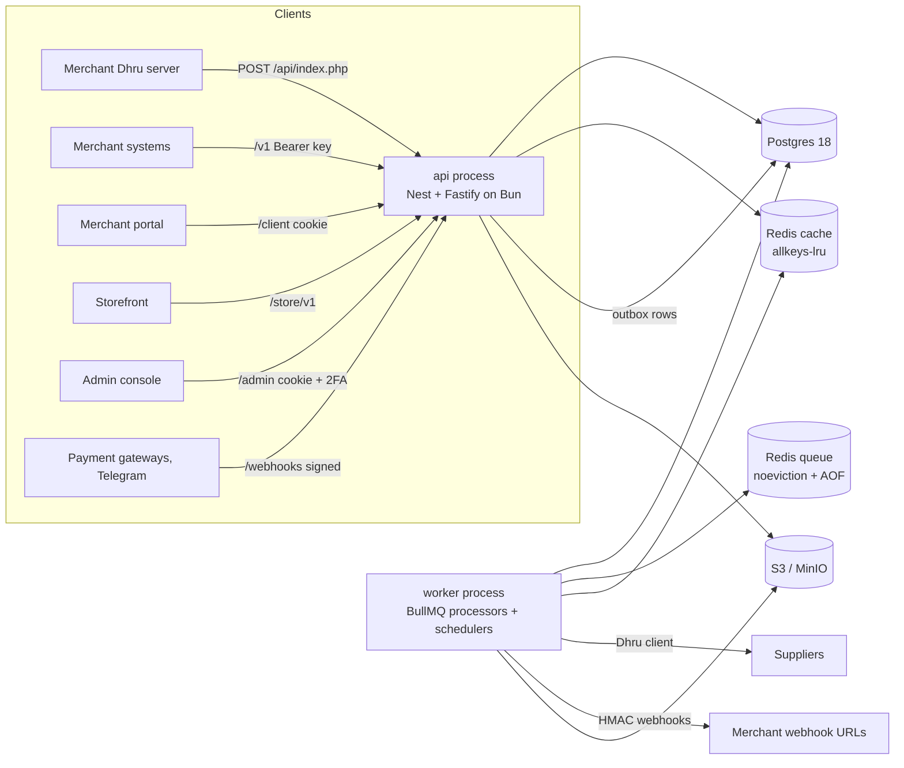

# Architecture

The GSM backend sells IMEI, Server, Remote and File services to B2B merchants (prepaid wallet; Dhru Fusion v6.1,
REST v1 and the merchant portal) and to B2C storefront customers (pay first, then dispatch). Both channels share **one
order engine, one supplier layer and one double-entry ledger**. Decisions referenced as (D0xx) live in
`docs/decisions/`.

## 1. Shape

- **Two processes, one codebase** (D016): `api` answers HTTP and never does slow work inline (it writes the DB and an
  outbox row, then returns); `worker` runs the outbox relay, BullMQ processors and job schedulers. Both run on Bun
  from TypeScript sources (D001).
- **Infrastructure**: Postgres 18 via Drizzle + pg (D005, D027); a queue Redis for BullMQ only and a cache Redis for
  cache, rate limits and locks (D006); S3-compatible storage (D004); a Prometheus server scraping both processes for
  the System health history (D015).

## 2. Modules

One Nest module per map domain (`scripts/module-map.mjs` is the source; `docs/slices/<module>.json` the brief input).

| Module | Domain | Owns (tables) | Main surfaces | Endpoints |
|---|---|---|---|---|
| identity | A | staff_users, roles, clients, sessions, auth_tokens, api_keys, kyc_submissions, ip_rules | admin, client | 59 |
| catalog | B | client_groups, service_categories, services, service_fields/options, group/client prices, pricing_rules, inventory_codes, tac_catalog | admin, client, v1, dhru | 43 |
| suppliers | C | suppliers, supplier_services, service_supplier_links, supplier_api_logs | admin, supplier calls | 18 |
| orders | D | orders, order_events | admin, client, v1, dhru, store, events | 40 |
| money | E | ledger (accounts, transactions, entries), currencies, invoices, payment_gateways, payments, withdrawal_requests, refunds, disputes, tax_rates | admin, client, v1, dhru, hooks, events | 57 |
| commissions | F | commission_plans, assignments, accruals | admin, client | 15 |
| platform | G | settings, notification_templates, notifications, webhook_endpoints/deliveries, outbox_events, audit_logs, files | admin, client, v1, hooks, system | 33 |
| health | G | service_checks, alert_rules, alert_events, incidents, job_runs | admin, system | 33 |
| storefront | H | service_listings, content_pages, help_articles, legal_documents | admin, store | 25 |
| customers | I | customers, customer_credentials, checkout_sessions, consent_records | admin, store | 28 |
| support | J | support_tickets, ticket_messages, reply_templates | admin, store | 14 |
| risk | K | imei_checks, risk_assessments, blocklist_entries, data_requests | admin, store | 17 |

**Boundaries.** A module reads and writes only its own tables. Other modules call its public service exported from
`src/modules/<id>/index.ts` (enforced by an ESLint boundary rule). Cross-module foreign keys stay in the database.
A use case that spans modules runs in one DB transaction passed explicitly (`tx`) to each public service it calls.

**Inside a module**: `controllers/` (HTTP only, thin, one per surface) → `application/` (use cases, transaction
boundary, authorization of ownership) → `domain/` (pure functions: pricing, state transitions, risk thresholds,
ledger lines; unit-tested) → `infra/` (Drizzle repositories, external clients). `contracts/` holds the zod route
contracts, `jobs/` the processors the worker registers, `db/schema.ts` the owned tables, `README.md` the module's
purpose, tables, routes, jobs, events, cache keys, permissions and scenarios.

## 3. Request pipeline

Fastify `onRequest` hooks (cheap, route-independent) then Nest guards, pipes and the handler (D018):

0. **CORS preflight** answered first, so a refused request still carries readable CORS headers.
1. **Request id** (`X-Request-Id` kept or generated, echoed; D012).
2. **IP rules**: active `ip_rules` cached in Redis (invalidated on change): block rules first; then, for `/admin`
   when the access restriction is on, the allowlist (`403 IP_NOT_ALLOWED`).
3. **Maintenance**: when on for a scope, `503 MAINTENANCE` (Dhru envelope on `/api/index.php`); never `/admin`.
4. **Rate limit**: per IP (D021); per-principal limits run in step 5 once the principal is known.
5. **Authentication** by surface: staff session cookie (admin), merchant session cookie (client), customer session or
   capability token (store), Bearer API key with scopes and allowed IPs (v1), username + apiaccesskey (Dhru),
   signature + replay window (webhooks), network or token (`/metrics`).
6. **CSRF** on every cookie-authenticated mutation (`403 CSRF_FAILED`).
7. **Permission**: the contract's `permission` (`resource:action`; `x:*` and `*` grant all actions of a resource).
8. **Validation**: zod contract pipes (`422 VALIDATION_FAILED`).
9. **Handler**; the response passes the response schema; admin writes are written to `audit_logs` (actor, action,
   entity, before, after, ip) by the audit interceptor.

Errors anywhere become problem+json (D028). CORS allows exact origins with credentials and exposes `x-total-count`,
`x-request-id`, `x-csrf-token`, `content-disposition`, `retry-after`. Security headers via @fastify/helmet; body limits
per route (uploads go through multipart limits).

## 4. Contracts, documentation and sync

Every endpoint is a zod contract (D008) that drives validation, handler types, response serialisation and the
OpenAPI metadata. Lists use the frontend's simple-rest dialect (`_start/_end/_sort/_order`, `q`, field filters with
`_ne/_gte/_lte/_gt/_lt/_like` suffixes, repeated keys = IN; array body + `x-total-count`). Wire conventions: camelCase,
numeric ids (D010), Money as 4-decimal strings (D011), ISO 8601 UTC timestamps with milliseconds. OpenAPI 3.1 is
generated into `docs/contract/` and served by Scalar (public REST v1 + Dhru reference at `/docs`; everything at
`/reference`, D017). Contract tests keep backend, map and frontend aligned (D009); the exact conventions per
endpoint are in `docs/contract/ALIGNMENT.md`.

## 5. Money

`postTransaction()` in the money module is the only ledger writer (D024): balanced lines, unique idempotency key
(replay returns the first result), accounts locked `FOR UPDATE` in id order, wallet overdraft guard, `balance_after`
written in the same transaction, append-only enforced by triggers, zero-sum enforced by a deferred constraint trigger.
Each of the 13 map money events has one line builder with a unit test. Balances and holds are never cached.

## 6. Orders

One engine for B2B and B2C (decision 025 holds the exact statuses and transitions). Every transition is a guarded
update (`UPDATE … WHERE id = $1 AND status = $2`) plus an `order_events` row in the same transaction. B2B: price
resolved at placement, the hold posted (`order` event) before dispatch; completion posts `complete`, rejection posts
`reject`. B2C: a checkout session locks price, tax and FX; the order is created only when the gateway webhook confirms
payment (`b2c_pay`, `b2c_fee`), then dispatched; delivery posts `b2c_deliver`. Dispatch and polling run in the
worker (`supplier-dispatch`, `supplier-poll`): poll every minute in the first hour, then every 5 minutes, then every
30 minutes (map); the switch to 30 minutes is a setting, default after 24 h (the map does not fix it). A supplier
timeout on dispatch never re-sends: `dispatch_state` becomes `needs_attention`, the status stays pending, the hold
stays, staff are alerted and resolve it with fetch or a manual dispatch (scenario `timeout`).

## 7. Async work

Outbox rows written with the state change; the relay moves them to BullMQ with `jobId = outbox:<id>` (D020). Every job
carries ids only, re-reads state and acts through guarded transitions; schedulers are upserted on every worker boot;
every run writes `job_runs`. Queues, payloads, idempotency keys, retries and schedules: `docs/queues.md`. Shutdown:
workers drain in `onModuleDestroy`, connections close in `onApplicationShutdown`.

## 8. Cache and limits

Cache-aside through `CacheService` (D022) with jitter, stampede locks, version keys and post-commit invalidation;
every key family in `docs/cache-keys.md`. Rate limits through `RateLimitService` (D021). Never cached: balances,
ledger, holds, decision-making statuses, risk decisions, idempotency results.

## 9. Security

Staff, merchant and customer sessions are opaque random tokens in httpOnly, Secure, SameSite cookies, stored hashed
(D019); CSRF and the sign-in steps follow the frontend contract (decision 018). Passwords argon2id (D007); TOTP and
supplier/gateway credentials AES-256-GCM with key ids; API keys and one-time tokens stored as keyed hashes; outgoing
webhooks HMAC-signed, incoming verified with replay protection; parameterized SQL only; no stack traces in production
errors; logs redacted (D012). Admin guards are enforced server-side: no self-suspension or self role change, at
least one active Owner, no self-lockout through IP rules, IP ranges no wider than /16.

## 10. Observability and testing

pino JSON logs with request ids across API, worker and supplier calls; Prometheus metrics on both processes;
`GET /health` checks Postgres and both Redis roles (D012, D015). Tests run on `bun test` (D014): unit (domain),
integration (real Postgres and Redis, concurrency and Redis-failure cases), one e2e test per map scenario, contract
tests, Dhru fixtures. `bun run check` is the CI gate.

## 11. Build order

Phase 2 builds the foundation (runtime, data layer, infrastructure, security pipeline, staff sign-in, contract-test
skeleton). Phase 3 follows the map's build stages: 2 identity + platform basics → 3 money → 4 catalog → 5 orders →
6 suppliers → 7 Dhru, REST v1, merchant API keys/webhooks, docs → 8 billing → 9 health and dashboard → 11
commissions and reports → 12 notifications, alerts, integrity → 14 storefront base → 15 content → 16 B2C payments,
refunds, disputes → 17 support → 18 risk and privacy → 19 growth. `PROGRESS.md` lists the features and their status.
