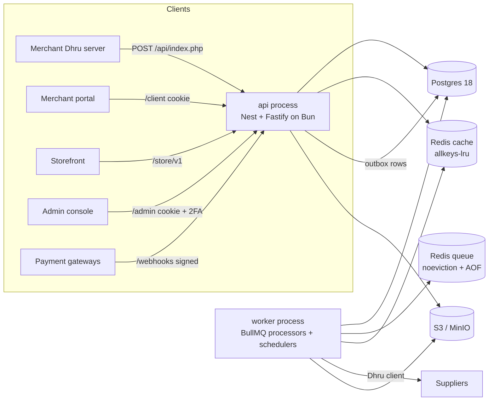

# Architecture

The GSM backend sells IMEI, Server, Remote and File services to accounts of two kinds of rank: merchants (prepaid or
credit wallet; Dhru Fusion v6.1 and the merchant portal) and retail buyers (storefront; pay first, then dispatch).
Merchants and retail buyers are **one account type in one table, told apart by the rank of the account** (decision 064).
Both doors share **one order engine, one supplier layer and one double-entry ledger**. Decisions referenced as (D0xx)
live in `docs/decisions/`.

## 1. Shape

- **Two processes, one codebase** (D016): `api` answers HTTP and never does slow work inline (it writes the DB and an
  outbox row, then returns); `worker` runs the outbox relay, BullMQ processors and job schedulers. Both run on Bun
  from TypeScript sources (D001).
- **Infrastructure**: Postgres 18 via Drizzle + pg (D005, D027); a queue Redis for BullMQ only and a cache Redis for
  cache, rate limits and locks (D006); S3-compatible storage (D004); a Prometheus server scraping both processes for
  the System health history (D015).

## 2. Modules

One Nest module per map domain (`scripts/module-map.mjs` is the source; `docs/slices/<module>.json` the brief input).

| Module | Domain | Owns (tables) | Main surfaces | Endpoints |
|---|---|---|---|---|
| identity | A | staff_users, roles, clients (every account), account_legacy_ids, sessions, auth_tokens, api_keys, ip_rules (kyc_submissions: retired, unread) | admin, client, store | 59 |
| catalog | B | client_groups, service_categories, services, service_fields/options, group/client prices, pricing_rules, inventory_codes, tac_catalog | admin, client, dhru | 41 |
| suppliers | C | suppliers, supplier_services, service_supplier_links, supplier_api_logs | admin, supplier calls | 18 |
| orders | D | orders, order_events | admin, client, dhru, store, events | 34 |
| money | E | ledger (accounts, transactions, entries), currencies, invoices, payment_gateways, payments, refunds, disputes, tax_rates, account_rank_changes, wallet_action_keys (withdrawal_requests: retired, unread) | admin, client, store, dhru, hooks, events | 55 |
| commissions | F | commission_plans, assignments, accruals (retired, decision 062: the schema only) | none | 0 |
| platform | G | settings, notification_templates, notifications, outbox_events, audit_logs, files (webhook_endpoints and webhook_deliveries are retired, unread) | admin, client, system | 20 |
| health | G | service_checks, alert_rules, alert_events, incidents, job_runs | admin, system | 33 |
| storefront | H | service_listings, content_pages, help_articles, legal_documents | admin, store | 25 |
| customers | I | checkout_sessions, consent_records (customers and customer_credentials: retired and frozen, unread) | admin, store | 28 |
| support | J | support_tickets, ticket_messages, reply_templates | admin, store | 14 |
| risk | K | risk_assessments, blocklist_entries, data_requests | admin, store | 14 |

**Boundaries.** A module reads and writes only its own tables. Other modules call its public service exported from
`src/modules/<id>/index.ts` (enforced by an ESLint boundary rule). Cross-module foreign keys stay in the database.
A use case that spans modules runs in one DB transaction passed explicitly (`tx`) to each public service it calls.
**Ports and registries** (decision 064): a module may have a `ports/` folder of abstract classes that other modules inject as Nest tokens (the
owning module implements them and the wiring binds them with `useExisting`) and small registries that modules fill at boot (rank change checks,
account create checks, guest claim participants, the account list's SQL fragments). A registry throws on a repeated name and on a read before
registration, so a missing entry is a boot error; the API refuses to start while one is missing. Pure helpers that modules share (the wallet kind
of a rank kind, the order door) sit in the owner's `domain/` folder.

**Inside a module**: `controllers/` (HTTP only, thin, one per surface) → `application/` (use cases, transaction
boundary, authorization of ownership) → `domain/` (pure functions: pricing, state transitions, risk thresholds,
ledger lines; unit-tested) → `infra/` (Drizzle repositories, external clients). `contracts/` holds the zod route
contracts, `jobs/` the processors the worker registers, `db/schema.ts` the owned tables, `README.md` the module's
purpose, tables, routes, jobs, events, cache keys, permissions and scenarios.

### 2.1 Accounts and ranks (decision 064)

- **One accounts table, `clients`.** A merchant and a retail buyer are the same kind of row; the **rank** (`client_groups`, kinds `b2b` and
  `b2c_retail`) says which: only `b2b` is a merchant, anything else has retail rights. A guest (`has_account = false`) is a retail row without a
  login. Email is unique among login rows and, separately, among guest rows; `AccountDirectory` is the only reader of an account by email.
- **One stored type word, `account`**, in every (type, id) pair. Old append-only rows keep their words and are read through
  `account_legacy_ids`; NOT VALID `*_current_check` constraints refuse the old words in new rows. An old customer number is never an account id.
- **One buyer column, `account_id`**; the door of an order is `orders.source` (`store` is the shop's door), never the rank held today.
- **One live wallet of the kind of the rank** (`client_wallet` and `client_hold` for a merchant rank, `customer_wallet` for the retail rank);
  the rank changes only through `POST /admin/clients/:id/rank` (money module, Owner only, idempotent), which moves the balance in one journal.
- **A default-deny rank gate** on every session route (merchant-session routes serve merchant ranks, customer-session routes the retail rank,
  `rank: 'any'` only for the routes pinned in `test/contract/rank-open-routes.ts`); the refusal is 403 `RANK_NOT_ALLOWED` and never ends a session.
- **One lock order for the money paths of an account:** the account row (`FOR UPDATE` by the rank change, status writers, the guest claim and
  erasure; `FOR KEY SHARE` by every path that reads the rank kind to move money), then the rows of the path (order, invoice, payment, dispute),
  then the advisory locks (`topup:<accountId>`, `upload-quota:account:<id>`, fingerprint and stock locks), then the ledger accounts `FOR UPDATE`
  in id order. The one named exception is `api-keys:<accountId>`, taken before the account row by a key creation (staff's, decision 067). Staff adjustments take
  `wallet-adjust:staff:<staffId>` first.
- The expand migration is assembled (`scripts/accounts-merge`), the old customer tables are frozen until the contract release, and the old
  customer routes answer 410 `ROUTE_RETIRED`; `docs/OPERATIONS.md` holds the release order.

## 3. Request pipeline

Fastify `onRequest` hooks (cheap, route-independent) then Nest guards, pipes and the handler (D018). Steps 2 to 4 are installed in
this order by one registry, `RequestPipeline` (`src/common/pipeline`, stages `ip-rules`, `maintenance`, `rate-limit`, `upload-session`), after CORS
and the request id; their refusals are problem+json with the CORS and security headers. Steps 5 to 7 are one global guard
(`AccessGuard`, identity module) that reads the route contract (`access`, `sessionStages`, `permission`, `csrf`); a route without
a contract is refused:

0. **CORS** by the path's surface (D045): the console's origins on `/admin` and `/reference`, the shop's on `/client` and `/store/v1`, none
   elsewhere. A preflight from a listed origin is answered first, so a refused request still carries readable CORS headers; any other
   `OPTIONS` request goes on through steps 1 to 4 and ends as 404.
1. **Request id** (`X-Request-Id` kept or generated, echoed; D012).
2. **IP rules**: active `ip_rules` cached in Redis (invalidated on change): block rules first; then, for `/admin`
   when the access restriction is on, the allowlist (`403 IP_NOT_ALLOWED`).
3. **Maintenance**: when on for a scope, `503 MAINTENANCE` (Dhru envelope on `/api/index.php`; a Dhru order placement is decided
   once the body is parsed); never `/admin`, `/health` or `/metrics`.
4. **Rate limit**: per IP (D021), and every incoming webhook per address (`webhook-intake`, D053); per-principal limits run in step 5 once the
   principal is known. A fourth stage, **`upload-session`** (D053), follows: a multipart body of a route that signs in with a session cookie is read
   only when the request carries a live session of the route's audience (`401` before the body is read otherwise).
5. **Authentication** by surface: staff session cookie (admin), the one account session cookie (client and store: every account, whatever
   its rank) or a capability token (store links), username + apiaccesskey with allowed IPs and a merchant rank (Dhru),
   signature + replay window (webhooks), network or token (`/metrics`). Behind a session the one handler checks, in this order: a live session
   (401), a status that may act (403 `ACCOUNT_SUSPENDED`), the session stage (401), the **rank** of the route (403 `RANK_NOT_ALLOWED`), then CSRF,
   permission and anti-bot below.
6. **CSRF** on every cookie-authenticated mutation (`403 CSRF_FAILED`); a mutation without a session on `/admin` or `/client` (and the
   `/store/v1` sign-in routes) needs an `Origin` of its surface, and an `originCheck` GET needs `Sec-Fetch-Site: same-origin` or such an `Origin`.
7. **Permission**: the contract's `permission` (`resource:action`; `x:*` and `*` grant all actions of a resource); some use cases also ask for a second permission (decision 046).
   **Anti-bot** (D034): a `/store/v1` or public `/client` route with `turnstile: true` needs a passing `X-Turnstile-Token` (`403 TURNSTILE_FAILED`; the merchant sign-in and forgot routes only while `TURNSTILE_MERCHANT_AUTH` is on, the default in production, decision 052); the
   verifier is Cloudflare's siteverify through `OutboundHttp`, or a dummy one without `TURNSTILE_SECRET_KEY` outside production.
8. **Validation**: zod contract pipes (`422 VALIDATION_FAILED`).
9. **Handler**; the response passes the response schema; admin writes are written to `audit_logs` (actor, action,
   entity, before, after, ip) by the use case (`AuditService.record(tx, ...)`, in its transaction), and an audit
   interceptor checks that every successful staff mutation wrote one (a 500 in development and tests, an error log in
   production; `audit: false` on the contract opts a sign-in step out).

Errors anywhere become problem+json (D028). CORS allows the exact origins of each surface (D045) with credentials and exposes `x-total-count`,
`x-request-id`, `x-csrf-token`, `content-disposition`, `retry-after`. Security headers via @fastify/helmet; body limits
per route (uploads go through multipart limits).

## 4. Contracts, documentation and sync

Every endpoint is a zod contract (D008) that drives validation, handler types, response serialisation and the
OpenAPI metadata. Lists use the frontend's simple-rest dialect (`_start/_end/_sort/_order`, `q`, field filters with
`_ne/_gte/_lte/_gt/_lt/_like` suffixes, repeated keys = IN; array body + `x-total-count`). Wire conventions: camelCase,
numeric ids (D010), Money as 4-decimal strings, 0 or more with at most 14 digits before the point unless a field is signed (D011,
D049), ISO 8601 UTC timestamps with milliseconds. OpenAPI 3.1 is
generated into `docs/contract/` and served by Scalar (public Dhru reference at `/docs`; everything at
`/reference`, D017). Contract tests keep backend, map and frontend aligned (D009); the exact conventions per
endpoint are in `docs/contract/ALIGNMENT.md`.

## 5. Money

`postTransaction()` in the money module is the only ledger writer (D024): balanced lines, unique idempotency key
(replay returns the first result), accounts locked `FOR UPDATE` in id order, wallet overdraft guard, `balance_after`
written in the same transaction, append-only enforced by triggers, zero-sum enforced by a deferred constraint trigger.
Each of the map's money events that can still be posted (12 of its 13; `commission` is retired) has one line builder with a unit test. Balances and holds are never cached.
A wallet is owned by (`account`, id): the live wallet follows the kind of the account's rank, a change of rank moves the balance in one `wallet_transfer`
journal, and every money path of an account follows the lock order of section 2.1 (decision 064).
Manual money is limited (D049): a staff member's credits are capped over 24 hours, a staff-issued invoice is approved by someone else,
one receipt backs one payment, and the shop charges only in currencies whose rate is fresh and was not held.

## 6. Orders

One engine for both doors (decision 025 holds the exact statuses and transitions; the door is `orders.source`, and the buyer of every order is an
account, decision 064). Every transition is a guarded
update (`UPDATE … WHERE id = $1 AND status = $2`) plus an `order_events` row in the same transaction. B2B: price
resolved at placement, the hold posted (`order` event) before dispatch; completion posts `complete`, rejection posts
`reject`. B2C: a checkout session locks price, tax and FX; the order is created only when the gateway webhook confirms
payment and the gateway's own record agrees (decision 048) (`b2c_pay`, `b2c_fee`), then dispatched; delivery posts
`b2c_deliver`. Dispatch and polling run in the worker (`supplier-dispatch`, `supplier-poll`): poll every minute in the first hour, then every 5 minutes, then every
30 minutes (map); the switch to 30 minutes is a setting, default after 24 h (the map does not fix it). A supplier
timeout on dispatch never re-sends: `dispatch_state` becomes `needs_attention`, the status stays pending, the hold
stays, staff are alerted and resolve it with fetch or a manual dispatch (scenario `timeout`). While the supplier call is in flight
the order is `dispatching` (decision 044): actions that would change it wait for the answer, and a sweep moves a claim whose answer
never came to `needs_attention`.

## 7. Async work

Outbox rows written with the state change; the relay moves them to BullMQ with `jobId = outbox-<id>` (D020). Every job
carries ids only, re-reads state and acts through guarded transitions; schedulers are upserted on every worker boot;
every run writes `job_runs`. Lost work is asked for again by a reconcile job whose passes the owning modules register; handed-over
outbox rows are kept 45 days; failed jobs at most 10 000 per queue (D055). Queues, payloads, idempotency keys, retries and schedules:
`docs/queues.md`. Database sessions carry statement, lock and idle-in-transaction limits per process (D055). Shutdown: workers drain
in `onModuleDestroy`, connections close in `onApplicationShutdown`.
Stored files that nothing references are deleted after 7 days by a daily job (D053); supplier call
logs are kept 90 days.

## 8. Cache and limits

Cache-aside through `CacheService` (D022) with jitter, stampede locks, version keys and post-commit invalidation;
every key family in `docs/cache-keys.md`. Entries are sealed with a key derived from the token pepper; a stale entry is served only
inside the reader's window; cached session and API key views are bound to their credential; invalidations after a security change
are retried (D055). Rate limits through `RateLimitService` (D021). Never cached: balances, ledger, holds, decision-making statuses,
risk decisions, idempotency results.

## 9. Security

Staff and account sessions (one session cookie for every account of any rank; its readable CSRF cookie is named by the rank kind) are opaque random
tokens in httpOnly, Secure, SameSite cookies, stored hashed (D019); CSRF and the sign-in steps follow the frontend contract (decision 018). Passwords argon2id (D007); TOTP and
supplier/gateway credentials AES-256-GCM with key ids; API keys and one-time tokens stored as keyed hashes; the shop's link tokens as a keyed hash and an encrypted copy; stored lookups keyed with their own key (D054); incoming webhooks verified with replay protection; parameterized SQL only; no stack traces in production
errors; logs redacted at every depth, database failures logged as SQLSTATE and names only (D012, D054). Admin guards are enforced server-side: no self-suspension or self role change, at
least one active Owner, no self-lockout through IP rules, IP ranges no wider than /16, and a privilege ceiling: nobody grants,
assigns or acts on permissions they do not hold, and only an Owner edits the role they hold; payment method secrets, merchant API
keys made by staff and IP changes that would shut out an Owner are kept for Owners (decision 046). Sign-in counters count per email
and network, every password attempt is counted for its email before the check (a correct one takes back only its own count), and ten
failed passwords lock an email for 15 minutes for every network its account has not signed in from (while the lock runs, each of the account's own networks
keeps a budget of five attempts per 15 minutes); temporary passwords expire after 72 hours; the mails a visitor can ask for are capped per
recipient (decision 052). The production stack keeps its tiers apart (decision 055): the database, both Redis instances, the object store
and the search engine are on internal networks that only the API, the worker and the tools reach; both Redis instances need a password;
the API trusts the client address from Caddy's and the site's two fixed addresses only; and the application connects with its own
database role, which cannot rewrite the ledger, the order events or the audit log, change the schema or empty a table. Staff see the addresses of accounts
masked unless they may read accounts (`clients:read`, for every rank), open a stored file only with the read permission
of every record that uses it, and cannot switch off the emails that protect accounts (decision 047).

## 10. Observability and testing

pino JSON logs with request ids across API, worker and supplier calls; Prometheus metrics on both processes;
`GET /health` checks Postgres and both Redis roles (D012, D015). Tests run on `bun test` (D014): unit (domain),
integration (real Postgres and Redis, concurrency and Redis-failure cases), one e2e test per map scenario, contract
tests, Dhru fixtures. `bun run check` is the CI gate.

## 11. Build order

Phase 2 builds the foundation (runtime, data layer, infrastructure, security pipeline, staff sign-in, contract-test
skeleton). Phase 3 follows the map's build stages: 2 identity + platform basics → 3 money → 4 catalog → 5 orders →
6 suppliers → 7 Dhru, merchant API keys/webhooks, docs → 8 billing → 9 health and dashboard → 11
commissions and reports → 12 notifications, alerts, integrity → 14 storefront base → 15 content → 16 B2C payments,
refunds, disputes → 17 support → 18 risk and privacy → 19 growth. `PROGRESS.md` lists the features and their status.
